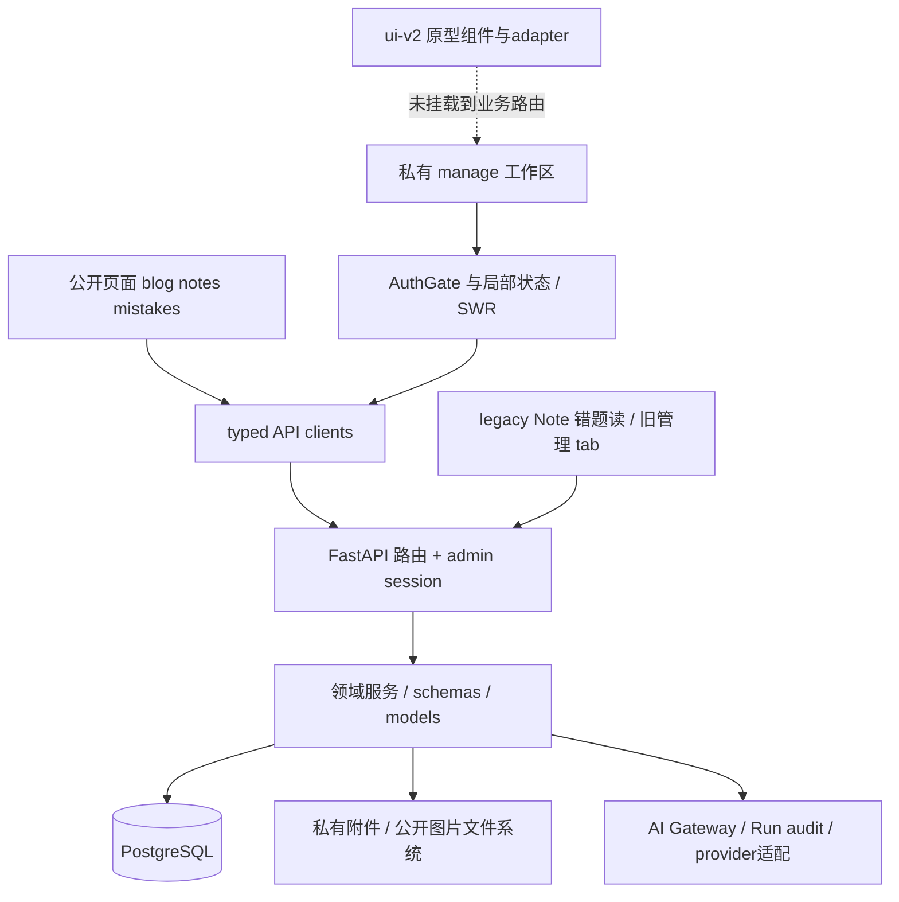

# 当前真实架构

日期：2026-10-09。工作区基线与范围见 [概览](../PROJECT_OVERVIEW.md)。本文描述当前源码，不把目标设计或历史测试当作当前运行事实。重要缺陷见 [审查](../audits/ARCHITECTURE_AUDIT.md)，静态目录/API全表见 [源码地图](../audits/CURRENT_SOURCE_MAP.md)。

> **2026-10-15 运行事实回写**
> - 数据库：开发库 `blog_v2` 已迁移至 **alembic 034**（`EXPECTED_ALEMBIC_REVISION="034"` 满足）；本文 §8 的 `NOT_VERIFIED` 现已有本地证据。
> - 测试：后端 `pytest` **958 passed / 9 skipped / 0 failed**（经 scratch 守卫）；前端 `test:typecheck` 0、`vitest` **531 passed**；`npm run build` 成功。
> - 运行：后端 `/api/health` 200；前端 `/manage` 正常（此前"加载中"已定位为陈旧运行产物并修复）。
> - 部署：前端 CF Worker 已部署且 post-deploy smoke PASS（`blog.limengyang.me` 200）。
> - 相关缺陷 A01–A06/A08/A11–A13 已在本轮修复（见 [审查](../audits/ARCHITECTURE_AUDIT.md) 与 `docs/domain-decisions-a07-a10.md`）。

## 1. 技术与交付边界

|层|当前实现|证据|
|---|---|---|
|Web|Next.js 16.2.12、React/ReactDOM 19.2.1、TypeScript、Tailwind、SWR、局部 Zustand|`package.json`；版本为清单声明，不是线上版本证明|
|前端交付|OpenNext Cloudflare build/preview/deploy|`package.json`、`open-next.config.ts`、`wrangler.toml`|
|API|FastAPI 0.115.12、Pydantic 2.11.1、async SQLAlchemy 2.0.41、asyncpg|`backend/requirements.txt`、`backend/main.py`|
|持久化|PostgreSQL + Alembic；文件系统保存附件/公开图片字节|`database.py`、attachment/notes服务|
|身份|数据库有状态管理员会话、密码/Passkey、challenge生命周期与throttling|`routers/auth.py`、`models/session.py`、`webauthn_challenge_service.py`|
|质量工具|Vitest/jsdom、两套TS检查、pytest、Playwright、smoke、ORM/catalog双门禁|CI及测试配置；本轮实际执行范围见证据文档|

当前仍是 `src/` + `backend/` 的单仓库 Web/API 组合。没有已落地的 Redis/RQ/Celery worker 服务、统一 `apps/*` monorepo、向量库或独立学习计划服务。



## 2. 前端真实结构

- `src/app/` 持有页面和路由专用交互；全局站点布局仍套在私有工作区外。`/manage` 既是登录入口，也保留历史 tab 管理；`/manage/(workspace)` 的 URL 为 `/manage/*`，有 AuthGate、sidebar/mobile-nav/topbar。
- 当前学习页面有 dashboard、notes/new/slug、questions（动态 `[id]` 特判 new）、drafts、mistakes、review、practice、subjects、knowledge-points、attachments、capture、ai/runs、settings。search 为 deferred；analytics/jobs 是治理摘要页，不是完整分析器或队列控制台。
- 常用路径为 `page/component → hook/本地 action → src/lib/api → FastAPI`。集中客户端 `src/lib/api/client.ts:75–109` 使用 `credentials: include` 与一致错误模型，`config.ts:12–19` 管 API base。
- SWR 负责 auth、内容索引、dashboard/profile/governance；表单和学习列表大量使用 React 局部 state。Zustand 主要用于首页布局/主题、阅读记录、viewport和旧写作预览，不是统一学习事实存储。
- `src/{contracts,mocks,adapters,components,features}/ui-v2` 有真实原型组件及测试、部分真实 fetch adapter，但 `src/app` 未引入 features/adapters。它是独立组件轨，不等于业务路由已替换。旧 README 已修正用途。
- `next.config.ts:46–53` 把 write/write-note/write-mistake及旧 review 入口导向 manage；旧源码仍存。`load-blog.ts` 静态 loader 非当前博客主线。
- 非学习域包括公开/受保护的 about、projects、pictures、share/bloggers/discover、snippets、music、guestbook、clock、SVG、image-toolbox、live2d和游戏展示；不能省略，也不能统一认定为公开可写。

## 3. 后端分层与真实偏差

入口 `backend/main.py` 注册路由与中间件，启动会检查 schema revision，当前 expected 为 `034`。`database.py:16–23` 在请求依赖退出时 commit/rollback。

`models` 是 ORM持久结构、`schemas` 是输入/响应、`services` 是业务行为、`routers` 是HTTP/授权编排。核心题目/错题/复习多遵循此结构；Note router 仍直接承担查询、标签、版本、链接和审计，legacy review 也直接使用 ORM，属于局部技术债，不是已经全面完成的薄路由架构。

静态 AST 检出 42 个 ORM table声明、197 个 router HTTP decorators、53 个 page.tsx；这些数目不代表数据库表实际存在或每条URL运行可达。SQL-owned迁移对象不全在ORM表声明内。

## 4. 数据权威与领域实体

|领域|当前实体/关系|数据与兼容边界|
|---|---|---|
|内容|Note（note/blog与历史mistake）、NoteVersion、NoteLink、Folder/Tag/Category、ManagedContentEntry|普通内容主线PostgreSQL；legacy错题写冻结|
|分类|Subject、KnowledgePoint、QuestionKnowledgePoint、KnowledgePointLink、NoteKnowledgePoint|题目专用与多态KP关联并存，PUT/PATCH不一致见审查A04|
|草稿/题库|DraftItem、QuestionDraft、Question、QuestionSource|human convert闸门；正式字段与旧字段双写兼容|
|练习|Attempt，context=practice/review/editor_check|没有 PracticeSession/StudyPlan实体；Attempt无KP/题目版本快照|
|错题/复习|MistakeDraft、Mistake、ReviewItem、ReviewRecord|错题保存确认时KP集合；Record可关联review Attempt|
|采集/文件|CaptureItem、Attachment、AttachmentLink|DB元数据+文件字节；公开notes上传图片另存public/images|
|身份/审计|User、AdminSession、AdminPassword、PasskeyCredential、WebAuthnChallenge、AuditLog|随机token哈希定位会话；后端授权|
|AI|AiRun、AiCallLog、creation_context/created_by/confirmed hash|生成审计和人审；并非所有AI调用都具有实体绑定|
|辅助|音乐/每日歌曲/推荐、guest messages等|独立领域，guest生命周期有专门migration治理|

`Question` 的 `stem_md/question_text`、`answer_data/correct_answer`、`analysis_md/explanation` 同时存在。`KnowledgePointLink.target_type/target_id` 为多态关系，target无数据库FK；`QuestionKnowledgePoint`是专用关系。并存有兼容目的，但写协议分叉会产生实际风险。

## 5. API与权限摘要

|路径|当前用途与授权|
|---|---|
|`/api/notes`|Note/Blog和legacy兼容读；写操作授权，旧mistake写冻结|
|`/api/admin/questions`|正式题目列表/创建/读取/PUT/PATCH/归档；router级admin|
|`/api/admin/mistakes`、`/api/admin/mistake-drafts`|canonical私有错题及人审草稿；含AI candidate/confirm|
|`/api/public/mistakes`|仅active+public错题列表，公开DTO allowlist，无public detail主线|
|`/api/admin/review/items`|canonical due、submit/records；私有|
|`/api/review/queue`、`/stats`、`/plan`|旧Note错题兼容读；旧SM-2写被冻结；不是canonical计划|
|`/api/admin/practice/today`、`/api/admin/attempts`|确定性选题与practice作答；再答为 `POST /api/admin/attempts/review` 生成review Attempt；private|
|`/api/admin/knowledge-points`、`/api/admin/notes`|KP分析与Note-KP等私有操作；具体decorator全表见源码地图|
|`/api/admin/captures`、`/api/admin/attachments`|私有采集、授权文件读取/转换|
|`/api/admin/ai/runs`、`/api/admin/governance`|审查/重试/治理摘要；不能据此称完整后台任务队列|

这是领域摘要，不是穷尽权限矩阵。实际URL以 [router清单](../audits/CURRENT_SOURCE_MAP.md) 为准。`get_current_admin`/router dependencies执行权限，前端 AuthGate只管体验。session token由服务端随机生成、以SHA-256哈希查询；`JWT_SECRET_KEY`名称仍留在配置/启动保护中，但不是当前 cookie token签名机制。GitHub私钥集成另属历史边界。开发/测试双开关AUTH_BYPASS + AUTH_BYPASS_ALLOW代码仍存在；main.py按声明ENV拒绝非开发环境双开关启用，本轮未验证实际部署配置。

## 6. 学习链逐段结论

```text
Question → practice Attempt → 错答 MistakeDraft（KP快照）
→ 人工确认 Mistake + ReviewItem
→ 再答review Attempt / 用户评分 → ReviewRecord + 调度状态
→ KP analytics → 今日选题 / Dashboard行动建议
```

|用户要求的段|源码结论|运行限度|
|---|---|---|
|题目→错题|自动错答草稿、手工错因草稿、人审convert均存在|本轮未执行HTTP/数据库保存|
|错题→复习任务|convert创建ReviewItem|并非持久StudyTask计划|
|复习任务→复习记录|row lock+expected schedule+0–5评分+可选attempt归属校验|首次架构审查静态契约通过，本次文档复查未重跑；事务竞争未验|
|复习记录→掌握度|ReviewItem连续至少4次评分≥3且末次评分≥4时进入mastered；KP统计review/lapse/due|无独立KP掌握度/BKT；评分连续成功不等于连续再答正确，允许普通评分|
|掌握度→学习计划|mastered/recent/weak排序影响Practice实时选题|没有持久计划及完成回流；legacy plan仍用Note|

canonical是`fixed_interval_v2`成功阶梯3/7/14/30天，lapse重置；旧SM-2不是当前canonical调度器。Practice判答仍值等同，Review有自动/半自动/人工三态，两者没有统一语义。

## 7. 采集与AI实际边界

Capture具有uploaded→人工题面PATCH→ready→convert的代码路径，OCR默认关闭不妨碍此路径。recognize/retry开关仍fail closed；本轮不调用真实provider。后台同步调用/状态记录不等于持久队列worker。

AI canonical候选当前落在“从题库记录错题”：正式Question+错误答案/错因→可选candidate→确认创建MistakeDraft。正常candidate保存created_by=admin.id；confirm拒绝非NULL owner不匹配，但保留NULL owner兼容；purpose/status/source question version、confirm行锁和同payload重放已实现；输入hash未比对、最终candidate快照缺失、通用decision未共享锁协议。详见 [当前AI治理](ai-governance.md)；不能宣称可信来源和审计全面闭合。

## 8. schema治理与运行未验证

AST迁移图：36 revisions、唯一head034、无缺parent；expected revision与catalog manifest均034。ORM autogenerate与SQL-owned allowlist/catalog definition比对分开治理；CI已配置`alembic check`和catalog gate。guest表的registry排除是历史治理安排，不能误称数据库不存在guest表。

本轮没有连接任何数据库、执行upgrade/check/catalog、启动服务或build。图完整与源码门禁存在不证明真实schema一致。真实迁移、SQL定义、回滚、存量映射及生产状态均`NOT_VERIFIED`。

## 9. 目标与当前的差异

长期设计中的content_items、knowledge_nodes/edges、publish_snapshots、Redis/jobs、TodayOrchestrator、BKT/KP Mastery、持久StudyPlan、完整PracticeSession、对象存储与monorepo迁移不是当前实现。ADR Accepted是设计接受，不能转化为代码完成。目标文件保留供后续决策，当前建议优先关闭已有契约/验收缺口，不引入额外抽象。
