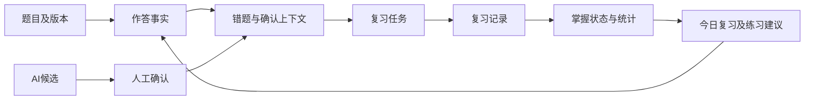

# 整体设计合理性：领域边界与体验质量

审查开始：2026-10-11；修订收尾：2026-10-12。Lead 最终设计判断；只读专项：design_backend_reasoning、design_frontend_reasoning。基线 `refactor/baseline@4a954eaa92952fcc5a6b18a2e15d2e824b094e41` 加当前 dirty 工作区。**本文是设计评估与建议，不是已实现架构、已批准 ADR 或产品验收结果。** 当前实现以 [ARCHITECTURE_CURRENT](ARCHITECTURE_CURRENT.md) 为准；既有问题与原计划分别见 [ARCHITECTURE_AUDIT](../audits/ARCHITECTURE_AUDIT.md)、[ROADMAP](../ROADMAP.md)。本阶段仅修改技术文档。

## 1. 总体裁决

后端保留 FastAPI + PostgreSQL + SQLAlchemy 的模块化单体最合理。当前规模下，单库事务、直接领域查询与明确用例比微服务、通用 Repository/UoW 框架、事件总线或图数据库更容易验证。现有服务并非全部需要拆分；真正需要收拢的是跨入口重复的关系写入、版本与确认规则。

前端保留 Next.js、现有 API clients、AuthGate 和可复用状态组件。公开站点服务阅读、个人表达与发现；学习工作台服务连续输入、纠错和复习。二者共享品牌与语义 token，分别拥有合适的页面布局。当前全站展示壳继续包住工作台，增加了导航、视觉与交互耦合。应先理顺布局职责，再提升视觉表现。

成熟度判断：**架构骨架合理，领域一致性和运行验收仍为 PARTIAL；前端视觉成熟度 NOT_VERIFIED。** 不能以文件分层、原型组件数量或历史测试绿证明系统已可靠，也不能从源码断言页面已经达到获奖水平。

## 2. 后端：以业务不变量划分职责

这里的单一职责指“一组共同变化的业务规则由一个边界负责”，并非每个函数只做一件机械操作。将错题、知识点快照、复习任务放在一个转换用例中原子生成，比让 HTTP 路由逐一调用三个彼此独立提交的服务更合理。

|边界|应负责的事实与操作|不应承担|
|---|---|---|
|Question|题面、答案、版本、题目知识点关系及其合法性|复习调度、AI 自动决定事实正确性|
|Mistake / Draft|错误来源、原因、人工确认、转换及错题上下文|偷偷重写原题或根据最新题目覆盖历史事实|
|Review|任务资格、到期、评分、记录、重复提交协议|复制题库编辑规则、把练习判题等同于复习评分|
|Practice / Attempt|练习选择、提交事实、判定及关联|为展示“今日计划”预先引入完整计划执行引擎|
|Note|保存用例、版本语义、标签/链接一致性|在路由内分散编排所有持久化规则|
|AI Gateway / Run|外部调用、来源与输入输出审计；领域确认由具体用例负责|通用确认接口绕过领域状态约束、自动覆盖可信数据|
|Dashboard / Today|只读组合、独立区块状态、可追溯来源|写业务状态、拥有新的掌握度真相|
|Attachment|文件身份、元数据、存储副作用及补偿|假设数据库 rollback 会自动撤销文件系统写入|

保留认证为跨域边界：后端 `get_current_admin` 授权，HttpOnly `admin_session` + AdminSession；AuthGate 仅负责体验。公开读取和私有学习数据的界线不因布局重组改变。安全成熟度需要权限、越权、会话与并发证据，本轮没有重新执行完整安全验收。

### 2.1 八项后端目标的具体落点

|目标|当前判断|最低必要调整|验收信号（后续执行）|
|---|---|---|---|
|架构清晰|router/schema/service/model 骨架可保留|把保存、确认、转换等用例边界说明清楚|一个入口能追溯到负责该规则的唯一操作|
|职责单一|转换/复习用例已有良好基础；Note 路由承担过多业务编排|先抽出 Note 保存用例，保留原接口|版本、正文、关系和审计同成同败|
|低耦合高内聚|主要耦合来自同一规则有不同写法|统一关系替换及 AI 决定协议|新增入口复用规则，无第二套状态机|
|数据一致|KP 双轨更新和 AI 决定协议有缺口|单事务关系替换、共同锁或 CAS、重放合同|两个独立事务竞争、故障注入、提交后新事务回读|
|接口稳定|已有 DTO/clients；兼容路径不能直接删|保留外部合同，在内部汇合用例；显式版本冲突与错误语义|旧新 clients 合同测试及错误路径均一致|
|安全可靠|会话授权边界明确，外部副作用需细化|创建型 AI 先建立可审计 Run；文件补偿策略明确|未授权无副作用，失败不产生可确认的无审计结果|
|易测易维护|纯调度/查询可独立测；mock 不证明数据库竞争|纯规则单测 + PostgreSQL 事务测试 + 三条真实用户流|失败能定位到规则/持久化/界面，而非只有总绿数|
|最低复杂度|没有证据要求分布式架构|先修共同不变量，按性能证据扩展|每个新增抽象隐藏真实规则；删除它会导致规则重复|

### 2.2 必须处理的设计问题及证据

以下优先级为建议执行紧迫度，不追加或重写原 B07/Week Gate。行号对应本轮工作区。

|编号 / 分类 / 优先级|已核事实与代码证据|影响与建议|
|---|---|---|
|DR-B01 / CONFIRMED_DRIFT / P0|`backend/app/services/question_service.py:312–326` 的 PUT KP 更新只改多态表；`:404–422` 的 PATCH 同时改 QuestionKnowledgePoint；读取`:192–219` 优先专用关系，`practice_service.py:98–109` 使用专用关系|编辑结果可能与读取/练习依据不一致。统一 replace-question-KP 操作；建议专用关系为规范来源，多态表暂作兼容投影。这是待实施设计，不授权删表或数据迁移。承接 A04/N03。|
|DR-B02 / DESIGN_GAP / P0|`ai_creation_service.py:106–198` 创建确认路径；`routers/ai_runs.py:83–101` → `ai_run_service.py:326–330,277–307` 通用读取/决定路径；`routers/admin_mistakes.py:206–237` 候选内容进入 hash 但未按采纳语义写入|统一同一 Run 的确认/拒绝竞争协议，区分“参考候选”和“采纳字段”，原子绑定实体与最终确认快照。保留领域差异，不建万能 AI 实体框架。承接 A01–A03/N02。|
|DR-B03 / TECH_DEBT / P1|`backend/app/routers/notes.py:329–375` 编排冻结判断、版本、正文、标签/链接及审计|改动 Note 保存需同时理解多项规则。提取保存用例前先确定 revision 冲突和版本快照语义；单纯搬文件不能解决并发。|
|DR-B04 / DESIGN_GAP / P1|`backend/app/database.py:16–23` 请求提交/回滚；`services/attachment_service.py:94–120` 文件替换及 flush 异常清理|flush 成功后的最终 commit 失败仍需补偿。先设计有界清理/孤儿扫描，记录身份与恢复规则；没有规模证据不引入分布式事务或任务平台。运行故障后果尚未复现。|
|DR-B05 / DESIGN_GAP / P1|`backend/app/services/ai_gateway.py:151–155` 审计开始失败可返回 None，`:305–335` 仍有 provider 调用路径|创建型 AI 应先取得可持久追踪的 Run，否则拒绝外部生成；临时润色是否允许降级另按已有合同保留。失败处理需任务类别区分，避免一刀切。|
|DR-B06 / TRANSITIONAL / P2|`backend/app/services/dashboard_service.py:215–279` 当前串行查询/局部回滚，与 ADR003 目标并行聚合有距离|当前可保留串行，先测延迟。若并行，每个并发分支独立 session；不能对同一 AsyncSession 直接 gather。区分“没有任务”与“模块不可用”。|

正向证据：`mistake_service.py:139–181` 已把 Draft 状态、Mistake、KP、ReviewItem 和重放串成用例；`review_item_service.py:21–26,62–81` 将固定调度与加锁提交分开；`practice_service.py:86–140` 可用确定性实时查询支撑今日练习。保留这些边界，针对例外修正。

### 2.3 闭环与尚需明确的产品语义

此图是目标职责关系；不表示每一箭头已端到端验收。当前 ReviewItem 的 mastered、KP 统计、确定性练习建议真实存在；独立 KP mastery 模型和持久 StudyPlan 尚不是当前闭环必需条件。先证明“旧事实导致合理建议，完成动作又更新事实”，再考虑自适应算法。

需要在对应实现任务中固化的语义及 Lead 建议：

- **AI 采纳**：默认明确展示可编辑的最终字段及差异；确认保存最终快照。仅参考也可成立，但名称与审计必须如实表示参考，不宣称已采纳候选。
- **历史 KP 归因**：先分别标明当前分类统计和历史事实。已有错题快照保持稳定；是否为所有 Attempt 增设快照取决于历史分析需求，不自动扩大 P0。
- **题目归档**：建议停止新练习，并暂停无法可靠作答的关联复习，保留记录。若产品选择“按快照继续复习”，必须所有入口一致使用该快照。当前 A08 未因建议关闭。
- **Note 版本**：建议以保存后的不可变内容快照解释用户可见版本，并以 expected revision 防止覆盖；落地前需核对旧版本读取和恢复合同，不直接改变旧数据语义。
- **掌握度**：复习评分、客观判题、KP 汇总属于不同信号，不用一个分数掩盖差异。保持现有固定阶梯，先补可追溯性。

## 3. 前端：奖项品质如何转成可执行目标

[Webby 官方评审](https://www.webbyawards.com/judging-criteria/)涵盖内容、结构导航、视觉、功能、交互、创新及整体体验，并强调适合受众与包容性。由此，本项目采用“阅读有辨识度、操作可信且顺畅”的方向。Awwwards、FWA 同为用户指定的品质参照；本轮未取得可核验的完整评分细则，不虚构其权重，不把以下内部标准写成官方评分或获奖承诺。

建议视觉方向是**个人学习手稿的编辑感**：以真实笔记、推导、错因与学习轨迹形成个性。公开页可有更强的标题节奏与叙事；工作台用安静背景、稳定导航和清楚的输入反馈。现有品牌色和组件可以渐进收敛，不新增第三套组件体系，也不照搬获奖站的装饰。

### 3.1 已核源码事实与视觉证据边界

- `src/layout/index.tsx:25–27,75–87` 全站展示壳承载导航、背景与 children；`src/app/manage/(workspace)/layout.tsx:11–17` 再添加工作台导航及 main。结构耦合与嵌套主区域已证实；实际拥挤程度尚需页面截图。
- `src/styles/theme.css:1–14` 与 `src/components/ui-v2/tokens.css:6–53` 存在两套视觉表达；`globals.css:5` 引入 V2 token 不代表 V2 prototype 已接管真实业务路由。共存是事实，“难看”不是源码结论。
- `src/layout/index.tsx:29–38` 处理 `(Ctrl/Cmd)+L` 和 `(Ctrl/Cmd)+,`，调用 preventDefault 并尝试跳转设置；实际浏览器是否把保留快捷键交给页面未验证。建议取消浏览器保留快捷键的覆盖，另设可发现且可关闭的应用快捷键。
- `src/styles/globals.css:29–32` 移除输入默认 outline，需逐控件核查替代 focus；不能推断全部控件没有焦点样式。`tokens.css:221–227` reduced-motion 覆盖有限，`src/layout/backgrounds/blurred-bubbles.tsx:296–318` 的背景循环需补同等策略。
- `src/app/manage/(workspace)/review/review-queue.tsx:381` 把 design.md、repetitions 等实现词带入用户提示；建议改成实际下一步与调度说明。`:383–387` 成功反馈需核验辅助技术公告。
- 保留已有优点：`src/components/async-state-panel.tsx:40–83` 的失败/重试状态、`src/app/manage/(workspace)/dashboard/dashboard-content.tsx:21–40` 的结果焦点管理、`src/app/manage/components/manage-mobile-nav.tsx:31–107` 的 Esc/焦点恢复、Review 的提交禁用与请求身份防护。先检查覆盖范围，再推广复用。

2026-10-11至12日设计阶段 IAB 访问用户已有 `localhost:2025` 实例：主页曾仅有 main 空区域；`/manage` 多次观察仍为“加载中”；随后 `/notes` 也只取得加载状态。临时截图 `/tmp/pls-design-2026-10-11/manage-loading.jpg` 仅证明当时观察阻断，不作为工作台视觉评分样本。未重新启动服务，未绕过认证，未提交业务数据；实例与源码构建是否一致、加载根因均未验证。实际桌面/移动页面、动效、对比度、真实输入流程与性能验收 **NOT_VERIFIED**。

### 3.2 八维自检矩阵

以下为项目建议验收标准和初始设计参数，需在真实内容中校准，不是已通过结果。

|维度|设计判断与改进方向|必须取得的证据|
|---|---|---|
|排版|建立标题/正文/辅助/数据四级语义；中文正文可从16–18px、1.65–1.85行高试起；公式与英文不能破坏基线|长短标题、中文夹英文、行内/块公式、长列表及缩放后的截图；正文与表单分别核查|
|留白|公开阅读与高密度工作台采用不同节奏；先收敛嵌套容器 padding，间距基于少量固定尺度|390/768/1440宽下首屏任务可见、长页节奏稳定；表格局部滚动，不使整页横溢|
|视觉层级|每个任务页面突出一个主要动作；状态、内容、解释与次要操作有明确顺序|首次进入能找到“今天先做什么”；导航不重复争夺注意；错误不会被装饰淹没|
|色彩|复用语义token：正文、次要文字、边界、强调、成功、警告、错误；状态不能只靠颜色|真实背景合成后的对比度测量、焦点和禁用状态；当前未测，不能宣称达标|
|动效|优先解释状态变化；反馈可从120–180ms、面板180–260ms试起；任务提交不等待装饰结束|reduced-motion、弱设备、长列表、反复开关的录像/性能记录；全站背景也遵从偏好|
|微交互|提交中防重、失败保留输入、成功可感知、焦点有去处；异步结果绑定当前实体|键盘全流程、迟到响应、双击、重试、切换A/B、读屏反馈及持久回读|
|响应式|围绕内容断点而非仅设备名；软键盘、底部安全区、菜单和公式单独处理|390/768/1440截图，窄屏与200%缩放检查；触控目标项目目标44px，真实尺寸实测|
|原创性|用真实学习内容与关系表达个人性；公开阅读和工作台保持共同品牌|与现有界面对照，说明每项独特表达服务何种阅读/学习动作；不把粒子、玻璃卡片本身当原创|

性能目标建议采用 [Core Web Vitals](https://web.dev/articles/vitals)：LCP ≤2.5s、INP ≤200ms、CLS ≤0.1，以第75百分位评估；本轮没有采集该数据。实验室测试用于定位，不能代替线上真实用户指标。基础可用性、内容与性能必须一起验收。

### 3.3 三条关键流程的验收矩阵

|流程|必须覆盖的状态|有效证据|
|---|---|---|
|Dashboard → Review → 再答/评分 → 下一次复习|正常、无任务、加载、失败重试、迟到返回、重复提交、任务切换|桌面/移动真实操作；当前题目与反馈一致；新请求查 Record/Attempt/到期状态|
|Capture → 人工题面确认 → 转换为草稿 → 草稿确认/正式转换|OCR关闭时仍可人工完成；A/B请求乱序；保存失败保留输入；转换重放|授权隔离数据、provider调用为0；Capture转换先读回Capture/QuestionDraft/MistakeDraft，再经独立草稿确认与正式转换检查Question/Mistake/ReviewItem；不得把两次转换合并验收|
|Notes → 创建/编辑 → 保存/发布 → 再次找到|长标题、多页列表、未保存离开、权限、失败重试、删除中、发布状态|键盘/触控流程，保存后的新请求内容与版本、公开/私有可见性分别核对|

这三条是本次体验审查切片，**不替代原五条 E2E 或 Week/B07 验收**。不使用截图证明持久化，也不使用 mock 测试证明真实浏览器体验。

## 4. 最小演进顺序及停止标准

|工作组（非新增串行依赖）|工作与原计划关系|依赖与退出条件|
|---|---|---|
|1|N00保护现场及建立可恢复基线；N01类型门禁|先明确可恢复源码与验证环境；任何schema变化前须核验B04定义门禁；既有TS FAIL不能绕过|
|2|N02 AI可信确认、N03关系合同（DR-B01/02）|保留B05与A04原反例；并发、回滚、新事务回读闭合|
|3|N04交互身份/列表可达性；布局职责、快捷键、状态语义小步收敛|当前页面可访问且构建来源明确；先录三条流程。布局改变不改变路由授权/数据所有权|
|4|按八维矩阵做真实页面视觉迭代，复用既有token/导航/a11y与UI V2组件|可选并行轨；先统一token和一条完整流程，再推广。PR20–26按ROADMAP各自功能/合同依赖另行选择，不是视觉达标或原M1–M4的前置|
|5|N05业务语义决策；Note用例及副作用边界按风险实施|第二阶段或只读并行研究；未纳入候选范围时不成为N06依赖。先定合同，再做最小调整；没有实测瓶颈不并行化Dashboard|
|6|N06原计划及B07完整验收；N07后续legacy收缩|N06在N00明确纳入的修复定版后执行，不等待未纳入范围的视觉迭代/N05；N07按原路线后续选择。保持既有批准和证据边界|

执行视觉迭代时：记录同一构建和固定数据 → 截取三条流程各状态 → 列出有证据的问题 → 每轮改变一组相关设计变量 → 桌面/移动/键盘/reduced-motion回归 → 独立复审。没有前后证据的“更高级”不足以接受变更。

“没有明显可提升之处”的操作定义：在上述页面、状态、尺寸和约束内，无未解决的高/中影响缺陷；低影响项已处理或明确记录成本取舍；关键流程、响应式与可访问性检查通过；独立复审无阻断。此时停止本轮，保留后续真实使用反馈。它不表示审美绝对最优、全站无缺陷或保证获奖。

## 5. 本阶段验证及未执行事项

Lead 直接复核 KP PUT/PATCH、AI确认/通用决定、请求事务、布局套叠、快捷键和ADR边界；Worker仅提供专项证据，最终取舍由Lead负责。最终文档链接、hash保护、独立复核结果见 [CURRENT_REVIEW_EVIDENCE](../audits/CURRENT_REVIEW_EVIDENCE.md) 和 [TRACKER](../audits/CURRENT_REVIEW_TRACKER.md)。

没有修改业务、测试、配置或迁移；没有运行新产品测试、数据库、provider、build、CI、生产操作或Git写入。既有10/09测试与审查结果保留原时点，不能视为本阶段重跑。设计分析可验收，页面视觉优化及业务改造尚未实施；当前浏览器阻断不被归因为已证实的新业务缺陷。
